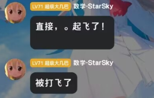
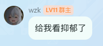
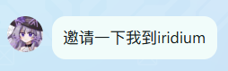
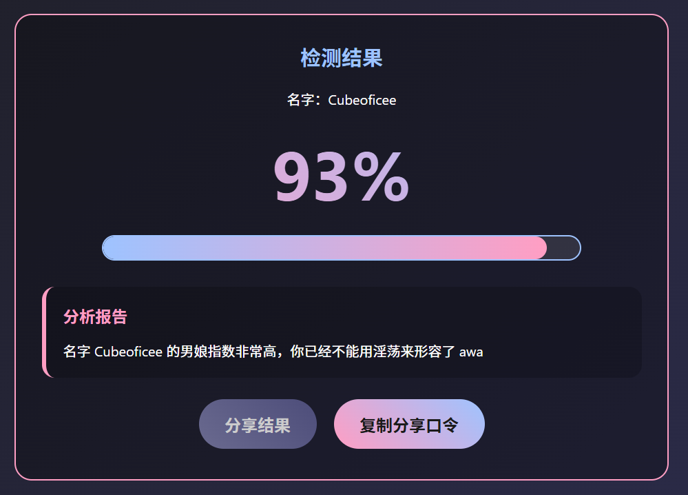
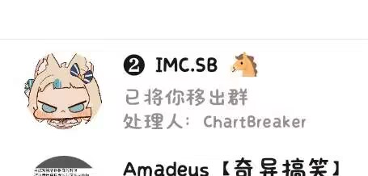

<p align="center">
  
  
  
  
  
  
  
  
  
  
</p>
<p align="center">
  
  
  
  
  
  
  
  
  
</p>

# IMCProxy-Free

让原版 Minecraft 客户端（1.8.9 / 1.12.2 Beta）连接 Eaglercraft WebSocket 服务器。

> **项目状态：2.0.0 免费版（C++ 重写）**
>
> 与正式版的区别：不连接 `imc.re`，没有浏览器登录与战绩 overlay，账号管理改为本地游戏账号。
>
> 交流群：**1131093494**

## 使用警告

本工具仅供学习与协议研究使用。

- 禁止使用本工具开挂、作弊或绕过任何服务器的反作弊规则
- 禁止使用本工具进行刷屏、骚扰或其他破坏他人游戏体验的行为
- 使用本工具产生的一切后果由使用者自行承担

## 功能

- 将 Minecraft TCP 协议转换为 Eaglercraft WebSocket 协议
- 支持原版 **1.8.9** 客户端（`tcpPort`，默认 25565）
- 支持原版 **1.12.2 Beta** 客户端（独立端口 `tcpPort1122`，默认 25566，服务器简介带 `[Beta]` 提示）
- 自动处理握手、皮肤、KeepAlive 等
- 随机 ID / 自定义 ID（服务器看到的是生成的名字）
- 优先使用游戏账号里绑定的 ID 进服（`randomId.preferAccounts`）
- 名称保护（只改客户端显示，不发给服务器）
- 服务器名伪装（imc → 自定义，只改客户端显示）
- 游戏账号管理器（`/gameadd`、`/gamedel`、`/gamestatus`、`/logingame`）
- 内嵌 Tab 战绩 overlay（数据来自 `api.imc.re`）
- 按服务器提示自动 `/login`、`/reg`
- 备份目录、每次运行的日志文件、内置更新日志
- 控制台颜色自适应（不支持 ANSI 时自动切换 Win32 颜色）
- 纯 C++ / CMake 构建，不依赖 Node.js

## 环境要求

- Windows 10 / 11
- CMake 3.20+
- MSVC（Visual Studio 2022 或更新）

## 快速开始

```powershell
cmake -S . -B build -G "Visual Studio 18 2026" -A x64
cmake --build build --config Release
.\build\Release\imcproxy.exe
```

打包（生成 `dist\versions\imcproxy-<版本>-win64\` 与 `dist\last\`）：

```powershell
.\scripts\pack.ps1
```

## 配置

配置在 `config.json`（严格 JSON），缺省项用内置默认值。

| 键 | 默认值 | 说明 |
| --- | --- | --- |
| `tcpHost` | `0.0.0.0` | 监听地址 |
| `tcpPort` | `25565` | 1.8.9 监听端口 |
| `tcpPort1122` | `25566` | 1.12.2 Beta 监听端口 |
| `enable1122` | `true` | `false` 关闭 1.12.2 监听 |
| `eaglerServer` | `wss://mc.smgoro.com` | 上游 Eaglercraft WebSocket 地址 |
| `eaglerOrigin` | `https://ws.imc.re` | 连上游时带的 Origin 头 |
| `eaglerUserAgent` | Chrome UA | 连上游时带的浏览器 UA |
| `maxPlayers` | `1` | 每个监听的最大玩家数 |
| `defaultSkinId` | `0` | 默认皮肤 ID |
| `debug` | `true` | 数据包级调试日志 |
| `randomId.mode` | `"startup"` | `off` / `startup` / `perConnection` / `pool` |
| `randomId.length` | `8` | 随机 ID 长度 |
| `randomId.preferAccounts` | `true` | 优先用 `game-accounts.txt` 里的账号 ID |
| `nameProtect.*` | 关闭 | 名称保护 |
| `serverNameSpoof.*` | 启用，`imc → hey pixel` | 服务器名伪装 |
| `overlay.*` | 启用，`auto` | Tab 战绩 overlay |
| `automation.*` | 启用 | 自动 `/login`、`/reg` 与游戏账号文件 |
| `api.*` | 启用 | HTTP API |

## 连接

- Minecraft **1.8.9** → `<代理IP>:25565`
- Minecraft **1.12.2** → `<代理IP>:25566`（服务器简介显示 `[Beta]`）

## HTTP API

代理运行时会在本机启动一个 HTTP 接口，可用脚本开关代理、读取或修改配置、执行控制台命令并拿到输出。

配置位于 `config.json` 的 `api` 段：

```json
"api": { "enabled": true, "host": "127.0.0.1", "port": 8790, "token": "" }
```

`token` 非空时，请求需要带 `?token=...` 或 `X-Api-Token` 头。

| 方法 | 路径 | 说明 |
| --- | --- | --- |
| GET | `/api` | 接口列表 |
| GET | `/api/status` | 运行状态、监听地址、在线玩家 |
| GET | `/api/config` | 全部配置项 |
| GET | `/api/config/<key>` | 单个配置项 |
| POST | `/api/config/<key>` | body `{"value": ...}`，校验后写入 |
| POST | `/api/start` / `/api/stop` | 启动或停止代理 |
| POST | `/api/command` | body `{"line": "/status"}`，返回命令输出 |
| GET | `/api/changelog` | 更新日志 |
| GET | `/api/version` | 版本号与版本列表 |

示例：

```bash
curl http://127.0.0.1:8790/api/status
curl -X POST http://127.0.0.1:8790/api/config/tcpPort -H "Content-Type: application/json" -d "{\"value\":25566}"
curl -X POST http://127.0.0.1:8790/api/command -H "Content-Type: application/json" -d "{\"line\":\"/help\"}"
curl -X POST http://127.0.0.1:8790/api/stop
```

非法值会被拒绝且不会写入 `config.json`，例如 `tcpPort` 传 `abc` 返回 400 与原因。

## 控制台指令

| 指令 | 说明 |
| --- | --- |
| `/help` 或 `?` | 帮助与命令列表 |
| `/status` | 当前监听、玩家数、账号池状态 |
| `/start` / `/stop` | 启动 / 停止代理 |
| `/changelog [all\|版本]` | 查看更新日志 |
| `/backup [标签]` | 立即备份配置与账号文件 |
| `/gamestatus` | 查看已保存的游戏账号 |
| `/logingame <序号\|账号>` | 指定下次进服使用的游戏账号 |
| `/gameadd <账号> <密码> [备注]` | 添加游戏账号 |
| `/gamedel <序号\|账号>` | 删除游戏账号 |
| `/setname <名字>`、`/randomname` | 设置 / 随机生成名称保护的显示名 |
| `/rid`、`/sid <id>` | 重新生成 / 指定随机 ID（3-16 位） |
| `/log [on\|off]`（或 `/debug`） | 开/关数据包调试日志，不用重启 |
| `/settings [段]` | 打印当前配置与所有可改键 |
| `/<配置项> [值]`、`/config <键> <值>` | 逐项读取或修改配置 |
| `/api` | 显示 HTTP API 地址与端点 |
| `/quit` | 退出 |

## 起床战争 Tab overlay

把 Tab 顶部换成起床战争战绩表，数据来自
`https://api.imc.re/stats/bedwars/players/<名字>`。

```json
"overlay": {
  "enabled": true,
  "mode": "auto",
  "apiBase": "https://api.imc.re",
  "refreshSeconds": 300,
  "topRows": 10,
  "decorateTab": true,
  "timeoutMs": 6000
}
```

- `auto`：聊天里出现起床战争提示时自动打开
- 每进来一个新玩家单独查一次，缓存超过 `refreshSeconds` 才重查
- 切换世界/房间（收到新的 `login` 包）会关闭 overlay 并清空本局数据
- 数据异常整行标红并加 `!`，底部显示自己的战绩

## 游戏账号

账号保存在 `game-accounts.txt`，每行一个：

```
# 账号 密码 [备注]
FreeAcct FreePass123 测试号
```

也可以使用旧格式 `game-account.txt`（单账号）：

```
username=FreeAcct
password=FreePass123
```

`randomId.preferAccounts` 为 `true` 时，进服会优先用 `game-accounts.txt` 里未被占用的账号 ID，并把该账号密码交给自动 `/login`。

## 与正式版的区别

| 功能 | 免费版 | 正式版 |
| --- | --- | --- |
| 1.8.9 / 1.12.2 代理 | 有 | 有 |
| 名称保护 / 服务器名伪装 | 有 | 有 |
| 本地游戏账号管理 | 有 | 有 |
| 自动 `/login`、`/reg` | 有 | 有 |
| imc.re 登录 / 绑定 / 封禁同步 | 无 | 有 |
| 浏览器（Edge/CDP）自动化 | 无 | 有 |
| 起床战争 Tab overlay | 有 | 有 |

## 已知问题

- 部分服务器的反作弊插件可能会误判
- 某些 Eaglercraft 特有功能可能不完全支持
- 服务器要求图片验证码时需要人工在游戏内输入

## 致谢

- [Eaglercraft](https://github.com/lax1dude/eaglerxserver) - Eaglercraft 服务器实现
- [minecraft-protocol](https://github.com/PrismarineJS/node-minecraft-protocol) - 参考的 Minecraft 协议实现
- 原 Eaglercraft-Reverse-Proxy 项目（仓库已关闭）
