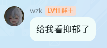
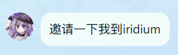
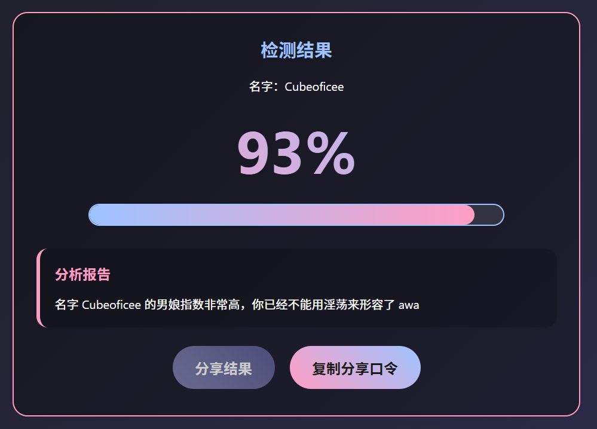
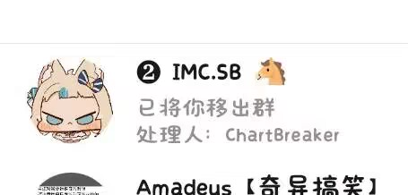
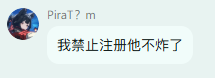

<p align="center">
  
  
  
  
  
  
  
  
  
  
</p>
<p align="center">
  
  
  
  
  
  
  
  
  
</p>

# IMCProxy-Free

让原版 Minecraft 客户端（1.8.9 / 1.12.2 Beta）连接 Eaglercraft WebSocket 服务器。



在增加反作弊和增加氪金玩家无敌之间选择了删除玩家

傻逼imc修复了个几把 我分分钟给你破了

使用Spam耀武扬威的司马了

> **项目状态：已暂停开发**
>
> 本项目已暂停制作新内容，仅维护现有功能可以正常工作。
>
> 交流群：**1131093494**

## 功能

- 将 Minecraft TCP 协议转换为 Eaglercraft WebSocket 协议
- 支持原版 **1.8.9** 客户端（`tcpPort`，默认 25565）
- 支持原版 **1.12.2 Beta** 客户端（独立端口 `tcpPort1122`，默认 25566，服务器简介带 `[Beta]` 提示）
- 自动处理握手、皮肤、KeepAlive 等
- 支持人人插
- 随机 ID / 自定义 ID（服务器看到的是生成的名字）
- 名称保护（只改客户端显示，不发给服务器）
- 服务器名伪装（imc → 自定义，只改客户端显示）
- 内嵌 Tab 战绩 overlay（数据来自 `api.imc.re`）
- 游戏账号管理器（`/gameadd`、`/gamedel`、`/gamestatus`、`/logingame`）
- 服务器公告与更新检查
- 备份目录、每次运行的日志文件

## 环境要求

- Node.js 18+
- npm

## 快速开始

```bash
npm install
npm run build
npm run start
```

Windows 也可以直接双击 `build-and-run.bat`。

## 配置

配置在 `config.json`（严格 JSON），缺省项用内置默认值。

| 键 | 默认值 | 说明 |
| --- | --- | --- |
| `tcpHost` | `0.0.0.0` | 监听地址 |
| `tcpPort` | `25565` | 1.8.9 监听端口 |
| `tcpPort1122` | `25566` | 1.12.2 Beta 监听端口 |
| `enable1122` | `true` | `false` 关闭 1.12.2 监听 |
| `eaglerServer` | `wss://mc.smgoro.com` | 上游 Eaglercraft WebSocket 地址 |
| `eaglerOrigin` | `https://ws.imc.re` | 连上游时带的 Origin 头 |
| `eaglerUserAgent` | Chrome UA | 连上游时带的浏览器 UA |
| `maxPlayers` | `1` | 每个监听的最大玩家数 |
| `defaultSkinId` | `0` | 默认皮肤 ID |
| `debug` | `true` | 数据包级调试日志 |
| `randomId.mode` | `"startup"` | `off` / `startup` / `perConnection` |
| `nameProtect.*` | 启用 | 名称保护 |
| `serverNameSpoof.*` | `imc → heypixel` | 服务器名伪装 |
| `overlay.*` | 启用，`auto` | Tab 战绩 overlay |
| `announce.*` | 启用 | 服务器公告 |
| `updateCheck.*` | 启用 | 更新检查 |

## 连接

- Minecraft **1.8.9** → `<代理IP>:25565`
- Minecraft **1.12.2** → `<代理IP>:25566`（服务器简介显示 `[Beta]`）

## 控制台指令

| 指令 | 说明 |
| --- | --- |
| `/help` 或 `?` | 帮助、当前模式与当前 ID |
| `/randomname`、`/randomid`、`/rid` | 重新生成一个随机 ID |
| `/setname <id>`、`/setid <id>`、`/sid <id>` | 使用自定义 ID（3-16 位） |
| `/log [on\|off]`（或 `/debug`） | 开/关数据包调试日志，不用重启 |
| `/backup` | 立即执行一次备份 |
| `/settings` | 打印当前配置与所有可改键 |
| `/proxy`、`/random`、`/console`、`/nameprotect`、`/servername`、`/announce`、`/updatecheck` | 分节配置：查看、读取或修改某项 |
| `/gamestatus` | 查看已保存的游戏账号 |
| `/logingame <序号\|账号> [密码]` | 用保存的账号登录游戏 |
| `/gameadd <账号> <密码> [备注]` | 添加游戏账号 |
| `/gamedel <序号\|账号>` | 删除游戏账号 |
| `/update` | 立即检查更新 |

## 游戏账号

账号保存在 `game-account.txt`，每行一个：

```
账号 密码 [备注]
```

`/logingame` 会用保存的账号自动登录，不需要在聊天栏手打密码。

## 起床战争 Tab overlay

把 Tab 顶部换成起床战争战绩表，数据来自
`https://api.imc.re/stats/bedwars/players/<名字>`。

```json
"overlay": {
  "enabled": true,
  "mode": "auto",
  "apiBase": "https://api.imc.re",
  "refreshSeconds": 300,
  "topRows": 10,
  "decorateTab": true,
  "timeoutMs": 6000
}
```

- `auto`：聊天里出现起床战争相关提示（例如提示正在连接 bw 房间）时自动打开，房间号会显示在标题里
- **每进来一个新玩家单独查一次**；重复进入用缓存，超过 `refreshSeconds` 才重新查
- 切换世界/房间（收到新的 `login` 包）会关闭 overlay 并清空本局数据
- 只显示接口真实提供的字段：Name、Final、F/D、Wins、W/L、Beds、BB/L、Ping、K/D
- 接口没有 `rating`，用 Rating Pro 公式本地估算
- 数据异常（样本太少却数值爆表等）整行标红并加 `!`
- 底部显示自己的战绩，用服务端 ID 查询，和名称保护互不影响

## 已知问题

- 部分服务器的反作弊插件可能会误判
- 某些 Eaglercraft 特有功能可能不完全支持

## 致谢

- [Eaglercraft](https://github.com/lax1dude/eaglerxserver) - Eaglercraft 服务器实现
- [minecraft-protocol](https://github.com/PrismarineJS/node-minecraft-protocol) - Minecraft 协议库
- 原 Eaglercraft-Reverse-Proxy 项目（仓库已关闭）
