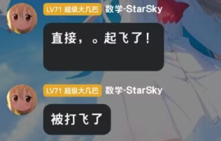
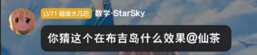
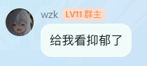
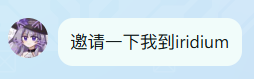
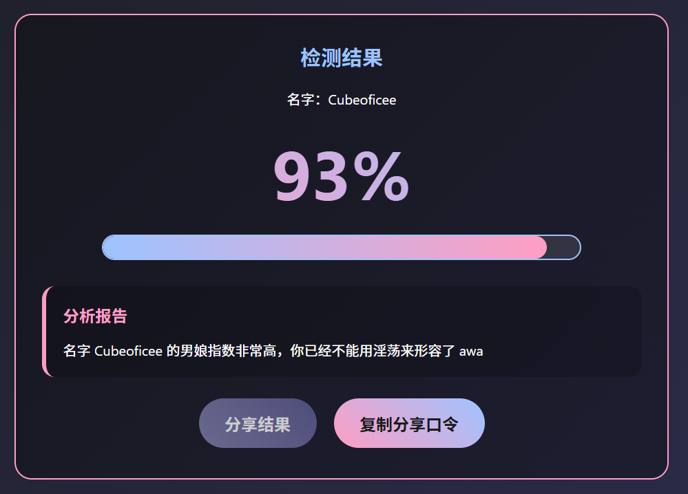
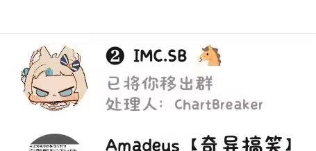

<p align="center">
  
  
  
  
  
  
  
  
  
  
</p>
<p align="center">
  
  
  
  
  
  
  
  
  
</p>

# IMCProxy-Free

让原版 Minecraft 1.8.9 客户端连接 Eaglercraft WebSocket 服务器。


在增加反作弊和增加氪金玩家无敌之间选择了删除玩家

傻逼imc修复了个几把 我分分钟给你破了

使用Spam耀武扬威的司马了

> **项目状态：已暂停开发**
>
> 本项目已暂停制作新内容，仅维护现有功能可以正常工作。
>
> 交流群：**1131093494**

## 功能

- 将 Minecraft TCP 协议转换为 Eaglercraft WebSocket 协议
- 支持原版 Minecraft 1.8.9 客户端
- 自动处理握手、皮肤、KeepAlive 等
- 支持人人插


### 环境要求

- Node.js 18+
- npm


### 配置

编辑 `src/reverse_proxy/config.ts`：

```typescript
export const config: ReverseProxyConfig = {
  tcpHost: "0.0.0.0",      // 监听地址
  tcpPort: 25565,          // 监听端口
  eaglerServer: "wss://你的服务器地址",  // Eaglercraft 服务器地址
  maxPlayers: 20,          // 最大玩家数
  defaultSkinId: 0,        // 默认皮肤 ID
  randomIdMode: "startup", // 随便ID模式: "off" | "startup" | "perConnection"
  randomIdLength: 8,       // 随机ID长度 (3-16)
  debug: false,            // 调试模式
};
```

### 运行

Windows:
```bash
build-and-run.bat
```

Linux/macOS:
```bash
npm run build
npm run start
```

### 连接

使用 Minecraft 1.8.9 客户端，服务器地址填写运行代理的机器 IP。


## 控制台指令

代理运行时，直接在运行代理的窗口里输入以下指令（回车生效）：

| 指令 | 说明 |
| --- | --- |
| `/randomname`、`/randomid`、`/rid` | 重新生成一个随机ID，之后的连接使用它 |
| `/setname <id>`、`/setid <id>`、`/sid <id>` | 使用自定义ID（3-16 位，只能包含 `a-z A-Z 0-9 _`） |
| `/log`（或 `/debug`）`[on\|off]` | 开/关数据包调试日志；不带参数就是切换。游玩中随时可用，不需要重启 |
| `/help`（或 `?`） | 显示帮助、当前模式与当前ID |


## 已知问题

- 部分服务器的反作弊插件可能会误判
- 某些 Eaglercraft 特有功能可能不完全支持


## 致谢

- [Eaglercraft](https://github.com/lax1dude/eaglerxserver) - Eaglercraft 服务器实现
- [minecraft-protocol](https://github.com/PrismarineJS/node-minecraft-protocol) - Minecraft 协议库
- 爱来自某人/Eaglercraft-Reverse-Proxy(已关库跑路)

